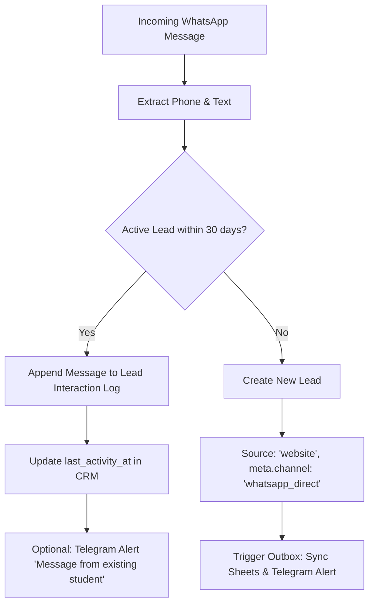

# WhatsApp Inbound Webhook — Architectural Design & Specification

This document defines the architecture for ingesting incoming customer WhatsApp messages into the Yog Jivan CRM pipeline when moving from manual WhatsApp Business app handling to official WhatsApp Cloud API webhooks.

---

## 1. Context & Operational Constraints

1. **Current Operations:**
   - Enquiries arrive via the website enquiry form (`/private-online-yoga`) or direct clicks to WhatsApp (`wa.me` links).
   - Owner uses the **WhatsApp Business mobile app** on the dedicated business phone number.
   - Internal operator lead recording is supported via `POST /api/public/leads/internal-capture` (authenticated via `INTERNAL_CAPTURE_TOKEN`).
2. **Future State (Cloud API Webhook):**
   - Direct inbound messages from prospective or existing students hit a webhook endpoint.
   - Must handle duplicate delivery, intermittent laptop connectivity (since n8n currently runs locally on the owner's Mac), and strict lead deduplication.

---

## 2. Ingress Architecture & Reliability Fallback

```
[Student on WhatsApp]
         │
         ▼
[Meta WhatsApp Cloud API]
         │ HTTPS POST (X-Hub-Signature-256)
         ▼
[Edge Ingress Webhook]  <── (Cloudflare Worker or Supabase Edge Function)
   │ 1. Validate HMAC signature
   │ 2. Deduplicate by wamid
   │ 3. Store raw event in `inbound_webhook_events`
   │ 4. Immediate HTTP 200 to Meta (prevents retries/backoff)
         │
         ▼
[Supabase Database]
   │ 5. DB Trigger / Queue: `inbound_webhook_events` (status: 'pending')
         │
         ▼
[n8n Automation Engine] (Runs locally or cloud)
   │ Polls or listens to pending queue
   │ - Processes payload
   │ - Resolves lead (Update vs. Create)
   │ - Syncs to Google Sheets operational mirror
   │ - Sends internal Telegram notification
```

### Why Edge Ingress is Mandatory
- **Laptop Availability:** The owner's primary n8n instance runs on a local MacBook. If Meta webhooks hit a local webhook URL (via tunnel or DDNS), closing the laptop or sleep mode causes Meta webhook timeouts, exponential backoff, and eventually webhook disabling by Meta.
- **Durable Buffer:** An edge receiver (Cloudflare Worker or Supabase Edge Function) guarantees 24/7 99.99% uptime, responds within <500ms to Meta, and stores payloads in Supabase with status `pending`. When the n8n runner wakes up, it drains the queue reliably.

---

## 3. Webhook Security & Verification

### Verification Handshake (`GET`)
Meta requires an initial verification challenge:
- Check `hub.mode === 'subscribe'`
- Verify `hub.verify_token === WHATSAPP_VERIFY_TOKEN`
- Return `hub.challenge` as plain text with HTTP 200.

### Signature Validation (`POST`)
Every incoming payload carries header `X-Hub-Signature-256: sha256=<signature>`:
```typescript
function verifyMetaSignature(payload: string, signatureHeader: string, appSecret: string): boolean {
  if (!signatureHeader || !signatureHeader.startsWith('sha256=')) return false;
  const signature = signatureHeader.substring(7);
  const hmac = crypto.createHmac('sha256', appSecret);
  const digest = hmac.update(payload).digest('hex');
  return crypto.timingSafeEqual(Buffer.from(signature, 'hex'), Buffer.from(digest, 'hex'));
}
```
If the signature is missing or does not match, return HTTP 401 immediately without processing.

---

## 4. Deduplication & Idempotency

Meta webhooks provide "at least once" delivery. Network blips can trigger 2 to 5 retries of the exact same message.

1. **Unique Key:** Extract `entry[0].changes[0].value.messages[0].id` (`wamid.HBg...`).
2. **Idempotency Check:**
   - Store incoming `wamid` in `inbound_webhook_events(event_id, source, status, created_at)`.
   - Table constraint: `UNIQUE (event_id)`.
   - On duplicate `wamid`: Return HTTP 200 immediately and discard subsequent duplicate processing.

---

## 5. Lead Resolution Logic (Update vs. Create)

Incoming messages are classified into two paths based on normalized phone (`e164` format):



### Rules:
1. **Existing Lead Match:**
   - Query `public.leads` for `phone = normalized_phone` with `created_at > now() - interval '30 days'` and status not in `('archived', 'lost')`.
   - If matched: Do **NOT** create a duplicate lead record. Instead:
     - Insert into `lead_interactions(lead_id, type, channel, body_preview, created_at)`.
     - Update `leads.updated_at = now()`.
     - Send lightweight Telegram notification: `💬 WhatsApp message received from existing student: [Name / Phone]`.
2. **New Lead Creation:**
   - If no active lead exists, invoke `/api/public/leads/internal-capture` or service-role DB procedure:
     - `source`: `'website'` (preserves DB constraint `source = ANY (ARRAY['website','website_paid_online_yoga'])`).
     - `meta`: `{"channel": "whatsapp_direct", "funnel": "cloud_api_inbound", "initial_message_preview": "..."}`.
     - `service`: classify or default to `'private'`.
     - `health_notes`: `null` (medical details must never be inferred or auto-ingested).
   - This fires the standard CRM outbox to mirror to Google Sheets and post the Telegram coordinator card.

---

## 6. Privacy & Compliance Boundary

- **No Medical/Health Ingestion:** Even if the customer describes a medical condition in WhatsApp chat, automation must keep `health_notes: null`. Health notes are recorded manually by authorized instructors during assessment.
- **Secrets Management:** `WHATSAPP_VERIFY_TOKEN`, `APP_SECRET`, and `INTERNAL_CAPTURE_TOKEN` are server-side secrets; never logged or exposed in client bundles.
- **Message Content in Telegram:** Telegram alerts should contain only sender name/phone, preferred service, and an excerpt/intent label — never full unredacted conversation transcripts.
