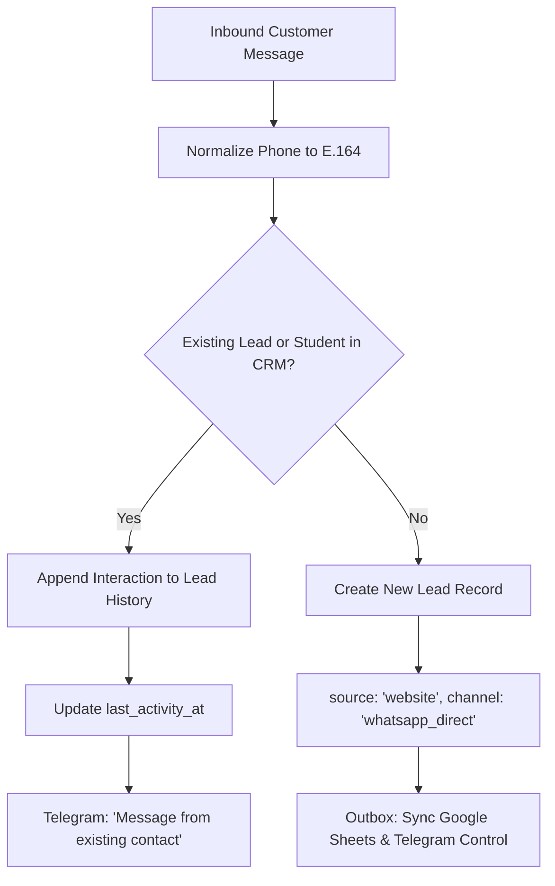

# WhatsApp Inbound Webhook — Architectural Design & Specification

> [!IMPORTANT]
> **STATUS: SPECIFICATION & DESIGN ONLY — NOT CONNECTED OR IMPLEMENTED IN PRODUCTION.**  
> The business continues to operate via the official WhatsApp Business mobile application. No Cloud API credentials, edge webhook workers, or inbound listeners are active in production.

---

## 1. Context & Operational Boundaries

1. **Current Production Operations:**
   - Enquiries arrive via the website enquiry form (`/private-online-yoga`) or direct clicks to WhatsApp (`wa.me` links).
   - The owner and instructors communicate directly with students using the **WhatsApp Business mobile application** on the dedicated business phone number.
   - Intake integrity: Supabase is the single source of truth; Google Sheets is an operational mirror; Telegram provides internal team notifications.
2. **Future Scope (Official Meta Cloud API Webhook):**
   - This document specifies the future architecture should the business choose to connect official Meta WhatsApp Cloud API webhooks.
   - It addresses durable buffering, payload deduplication, idempotent retries, signature security, privacy protection, and laptop availability fallbacks.

---

## 2. Ingress Architecture & Durability Buffering

```
[Student on WhatsApp]
         │
         ▼
[Meta WhatsApp Cloud API]
         │ HTTPS POST (X-Hub-Signature-256)
         ▼
[Edge Ingress Webhook]  <── (Cloudflare Worker or Supabase Edge Function)
   │ 1. Validate HMAC signature (timing-safe)
   │ 2. Distinguish messages vs status callbacks
   │ 3. Deduplicate by wamid
   │ 4. Durably persist event in `inbound_webhook_events` (status: 'pending')
   │ 5. Respond HTTP 200 to Meta ONLY after durable write succeeds
         │
         ▼
[Supabase Database: `inbound_webhook_events`]
         │
         ▼
[n8n Automation Engine] (Runs locally or in cloud)
   │ Polls or processes pending queue
   │ - Resolves contact by normalized phone (e164)
   │ - Existing contact: appends interaction; preserves identity & UUID
   │ - New contact: creates lead with source='website', channel='whatsapp_direct'
   │ - Dispatches operational Sheet mirror & internal Telegram alert
```

### Ingress & Acknowledgment Rules
- **No Unmeasured SLA Claims:** Webhook ingress does not make speculative sub-second latency or 99.99% uptime claims.
- **Durable Write Before ACK:** The edge webhook responds with HTTP 200 **only after** the payload is committed to persistent storage (`inbound_webhook_events`). If persistence fails, the endpoint returns HTTP 500 so Meta will retry with standard exponential backoff.
- **Intermittent Local Availability:** Because the owner's n8n runner operates on a local MacBook that sleeps and disconnects, Meta webhooks must never point directly to a local URL. The edge ingress worker acts as a 24/7 shock absorber.

---

## 3. Webhook Security & Signature Verification

### Handshake Challenge (`GET`)
Meta requires an initial verification handshake:
- Validate `hub.mode === 'subscribe'`.
- Validate `hub.verify_token === WHATSAPP_VERIFY_TOKEN`.
- Return `hub.challenge` as plain text with HTTP 200.

### Payload Signature Verification (`POST`)
Every incoming POST carries header `X-Hub-Signature-256: sha256=<signature>`:
```typescript
import crypto from "node:crypto";

export function verifyMetaSignature(
  rawBody: string | Buffer,
  signatureHeader: string | null,
  appSecret: string
): boolean {
  if (!signatureHeader || !signatureHeader.startsWith("sha256=")) {
    return false;
  }
  const signatureHex = signatureHeader.slice(7).trim();
  // SHA-256 hex digest must be exactly 64 characters
  if (signatureHex.length !== 64 || !/^[0-9a-f]{64}$/i.test(signatureHex)) {
    return false;
  }
  const hmac = crypto.createHmac("sha256", appSecret);
  hmac.update(rawBody);
  const expectedHex = hmac.digest("hex");

  // Constant-time comparison to prevent timing attacks
  return crypto.timingSafeEqual(
    Buffer.from(signatureHex, "hex"),
    Buffer.from(expectedHex, "hex")
  );
}
```
If the header is missing, malformed, or fails comparison, the endpoint returns HTTP 401 immediately without logging raw customer data.

---

## 4. Multi-Message Handling, Status Callbacks & Deduplication

Meta webhook payloads frequently bundle multiple items or status updates:

1. **Status Callbacks (`statuses` array):**
   - Delivery receipts (`sent`, `delivered`, `read`) arrive in the same webhook stream.
   - Status callbacks must be acknowledged with HTTP 200 and optionally logged for delivery telemetry, but **must never** trigger new lead creation or Telegram alerts.
2. **Multiple Entries & Messages:**
   - Iterate over `entry[].changes[].value.messages[]`. Each message carries a distinct `id` (`wamid.HBg...`).
3. **Idempotency Check:**
   - Store `event_id = message.id` in `inbound_webhook_events(event_id, ...)`.
   - Table constraint: `UNIQUE (event_id)`.
   - If an event with the same `wamid` already exists (network retry), acknowledge HTTP 200 and skip downstream processing.

---

## 5. Contact Resolution & Lifecycle Rules

Incoming messages are resolved against existing student records using normalized phone numbers:



### Lifecycle Rules:
1. **Never Fragment Existing Contacts:**
   - Match by `normalized_phone`. If a lead or student already exists, **do not create a duplicate lead**, regardless of whether their last enquiry was 5 days or 50 days ago.
   - Append the event to `lead_interactions(lead_id, channel, created_at)` and update `leads.updated_at`.
   - Preserves historical continuity, teacher assignments, and customer UUIDs.
2. **New Enquiry Creation:**
   - When no record exists for the phone number, create a lead with:
     - `source`: `'website'` (enforcing DB check constraints).
     - `meta.channel`: `'whatsapp_direct'`.
     - `health_notes`: `null` (medical conditions must never be inferred from chat).
     - Standard outbox triggers then handle Sheet mirroring and Telegram alerts.

---

## 6. Privacy, Health Data & Data Minimization

- **No Clinical or Health Data Ingestion:** Even if a customer discusses health conditions in chat, automated webhook ingestion must set `health_notes: null`. Health assessments are private, verbal consultations conducted by teachers.
- **Telegram Redaction:** Telegram notification cards must **never** contain raw message excerpts or conversation transcripts. Telegram alerts state only the student's name, phone number, and a direct link to open the conversation in WhatsApp Business.
- **Retention & Queue Cleanup:** Raw webhook payloads in `inbound_webhook_events` are purged automatically after 14 days by a scheduled maintenance query.
